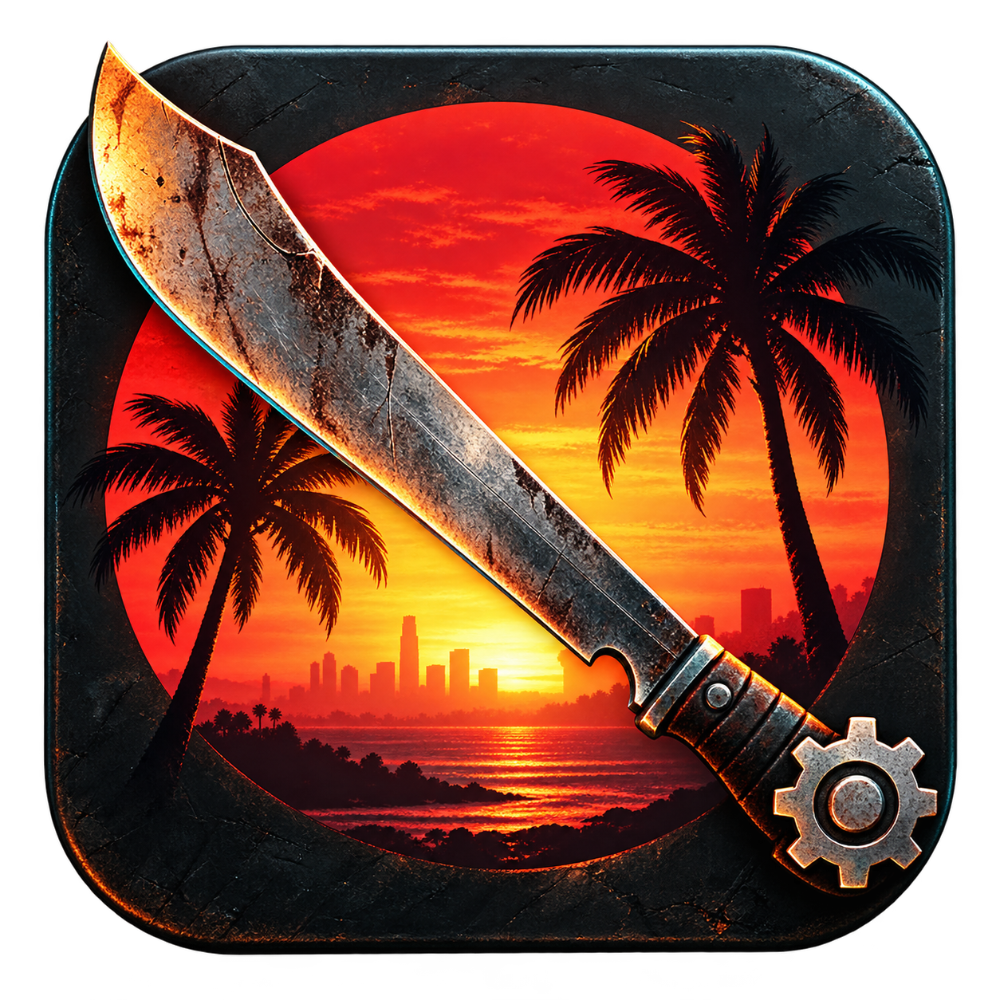

# Dead Island 2 Save Mac



Eigenständiger macOS-Save-Editor mit **SwiftUI**, einem direkt öffnenden
**Xcode-Projekt** und eigenem Lese-/Schreibkern. Keine Installation von `di2save`,
Python-Paketen oder Homebrew-Bibliotheken für die App nötig.

Version **0.4.1** · macOS **14+** als Deployment-Ziel · **AGPL-3.0-or-later**

Änderungen je Version stehen im [Changelog](CHANGELOG.md).

## Web-Version

Der Editor enthält zusätzlich eine Browser-Oberfläche für dieselben unterstützten
Save-Bearbeitungen. Der vorhandene Swift-Kern wird als WebAssembly wiederverwendet;
Save-Dateien bleiben im Arbeitsspeicher des Browsers und werden nicht hochgeladen.
Original-Backup und bearbeiteten Save separat herunterladen und die Datei bei
beendetem Spiel selbst ersetzen. Automatische Mac-Pfadsuche und Cloud-Abgleich
bleiben Aufgaben der nativen Umgebung beziehungsweise des Spiels.

[Web-Editor öffnen](https://darkuser89.github.io/dead-island-2-savemac/).
Funktionen, Browsergrenzen, lokaler Build und GitHub Pages stehen in der
[Web-Anleitung](web/README.md).

## Funktionen

- Lokale Mac-Spielstände der Steam- und Mac-App-Store-Version finden und öffnen.
- Version anhand des Speicherpfads zuordnen; geschützte Ordner oder einzelne
  `.sav`-Dateien über den nativen Dateidialog auswählen.
- Charaktere und Account-Lager auswählen; vorhandene Erfahrungspunkte, Wut,
  Medkits, Mengen und unterstützte Waffen-Laufzeitwerte bearbeiten.
- Geld ändern oder einen fehlenden Geld-Eintrag anlegen; XP maximieren.
- Waffenlevel, Seltenheit, Seed und Haltbarkeit ändern (`voll` stellt die volle
  Haltbarkeit ein). Vorhandene Munitionseinträge bearbeiten, soweit erkannt.
- Gegenstände mit Namen anzeigen, duplizieren, entfernen oder zwischen
  Charakterinventaren und Lager kopieren beziehungsweise verschieben.
- Neue Waffen, Materialien, Munition und Verbrauchsartikel aus einem optionalen
  CSV-Katalog hinzufügen; passende Kategorien gesammelt vormerken.
- Mods und Perks hinzufügen und entfernen. Die Upgrade-Anzahl wird gemeinsam
  mit den Einträgen verwaltet. Der Katalogfilter berücksichtigt auch Nahkampfwaffen
  aus dem Prolog, deren Assets außerhalb des Melee-Ordners liegen.
- Bekannte Baupläne und Curveballs über ihre **Freischaltungslisten** aktivieren
  oder deaktivieren, einzeln oder gesammelt. Weitere vorhandene Freischaltungen
  aus einem anderen eigenen Save einlesen.
- Quests und einzelne Questziele umstellen, Anzeigeindizes bearbeiten,
  Quests samt Zielen abschließen oder zurücksetzen und vorhandene Checkpoint-Ziele ändern.
- Bekannte Skillkarten anzeigen, freischalten, ausrüsten, ersetzen und ablegen;
  Kategorien und bekannte Kartenslots freischalten oder sperren.
- Vollständiger Sammlungskatalog der geprüften installierten Mac-Version 0.6.4:
  **572 IDs in zwölf Tabellen** – 347 Tagebuch-Einträge, 153 Schlüssel,
  27 Schlüsselkarten und 45 Sicherungsräume, einschließlich Erweiterungen.
  IDs einzeln, pro Tabelle oder gesammelt aktivieren/deaktivieren.
- Weltzustände: eindeutig zugeordnete Türen/Behälter, Generatoren und
  Magnetverschlüsse anhand von Gebiet, Level und Objektname anzeigen und
  gespeicherte Schalter einzeln bearbeiten.
- Questbelohnungs-Definitionen aus 99 Questpaketen anzeigen. Bei vollständig
  unterstützten festen XP-/Geldbelohnungen normalen Erstabschluss und Gutschrift
  gemeinsam vormerken; unbekannte Loot- und Sonderbelohnungen sperren die Aktion.
- Vier nachgewiesene Save-Buildkennungen lesen und beim Schreiben beibehalten:
  `0x00100286`, `0x0010d833`, `0x0011e5f3`, `0x0012fee2`.
  Die Dateiendung `.sav` genügt, auch bei umbenannten Dateien.
- Rückgängig und Wiederholen (`⌘Z` / `⇧⌘Z`) für vorgemerkte Änderungen,
  einschließlich gruppierter Inventaraktionen; bis zu 100 Bearbeitungsschritte pro Fenster.
- Warnung bei ungespeicherten Änderungen beim Fensterschließen und Beenden mit
  **Speichern**, **Abbrechen** und **Verwerfen**. Noch nicht übernommene Werteingaben
  werden beim Speichern validiert und übernommen.
- **Original speichern** (`⌘S`): vor dem Ersetzen den bisherigen Dateistand sichern.
  Original manuell sichern, Backup wiederherstellen oder separat exportieren
  (`⇧⌘S`).
- Zstd-Blöcke und CityHash64-Prüfsumme selbst lesen, schreiben und verifizieren.
  Unbekannte Daten und die originalen Headerbytes bleiben erhalten.

Änderungen werden zunächst vorgemerkt. Erst **Original speichern** schreibt sie
in die vom Spiel geladene Datei; **Exportieren** schreibt eine separate Datei.
**Zurücksetzen** verwirft vorgemerkte Änderungen. Der Bereich **Erweitert** enthält
auch erkannte Rücksetzdatensätze und zusätzliche numerische Laufzeitwerte.

Nur die eigentlichen Systemfäuste (Bare Hands und Fury Fists) sind gegen Entfernen
und Duplizieren geschützt. Schlagringe sind normale Waffen und bleiben sichtbar. Noch
referenzierte, etwa ausgerüstete Gegenstände müssen zuerst im Spiel abgelegt
werden, bevor sie entfernt oder verschoben werden können. Unbekannte innere
Formate werden nicht strukturell verändert. Charaktererstellung und DLC-Berechtigungen
sind keine implementierten Bearbeitungsfunktionen. Bei unbekannten Upgrade-Daten
zeigt die Waffenansicht einen Hinweis; diese Mods-/Perk-Listen bleiben unbearbeitbar.
Gültige Upgrade-Strings mit zusätzlichen nachgestellten Daten werden unterstützt;
diese zusätzlichen Bytes bleiben erhalten (unter anderem bei PEGGY, Officer's Sword
und Machine Pistol aus dem geprüften Steam-Save). Freischalten eines bekannten DLC-Eintrags erteilt keine
DLC-Lizenz; Erweiterungstabellen sind zunächst ausgeblendet.

## Quests, Skillkarten und Sammlungen

Im Menü **Bereich** stehen die drei eigenen Ansichten bereit. Auch deren Änderungen
werden zunächst vorgemerkt, mit Rückgängig/Wiederholen verwaltet und erst mit
**Original speichern** oder **Exportieren** geschrieben.

Quests zeigen die im Charakter gespeicherten internen Namen. Queststatus und einzelne
Zielzustände sind getrennt bearbeitbar. **Mit allen Zielen abschließen** und
**Quest zurücksetzen** ändern sie gemeinsam; Zurücksetzen leert zusätzlich die
Checkpoint-Ziellisten. Die normalen Statusaktionen führen Weltobjekte, Belohnungen, Erfolge und globale
Abschlusszähler nicht automatisch mit. Die Funktion kann diese Spielzustände daher
nicht als vollständig durchgespielte Quest herstellen. Checkpoint-Namen werden
unverändert aus dem Save verwendet.

Die zusätzliche Aktion **Standardabschluss mit XP/Geld** verwendet feste Werte aus
den lokal geprüften Quest-/Belohnungsdefinitionen. Sie gilt ausdrücklich für den
normalen Erstabschluss ohne New Game Plus und wird nur für den geprüften aktuellen
Mac-Save-Build angeboten. Ältere Saves zeigen die aktuellen Mac-Definitionen lediglich
zur Information; deren Gutschrift bleibt gesperrt. Bei bereits abgeschlossenem oder schon
vorgemerktem Abschluss wird keine zweite Gutschrift erzeugt. Sobald die Definition
zusätzlichen Loot oder einen nicht unterstützten Belohnungstyp enthält, bleibt die
Aktion gesperrt. Wiederholungs- und NG+-Regeln werden nicht emuliert; für solche Fälle
bleibt die normale Statusbearbeitung separat. Ein bewusstes Zurücksetzen und Speichern
einer Quest ist kein dauerhafter Schutz gegen erneute Belohnungsgutschriften.

**Weltzustände** bearbeitet vorhandene einzelne Schalter. Diese Änderungen führen
keine Questskripte aus. Die automatische vollständige Zuordnung einer Quest zu
Türzuständen, Strom, NPCs, Spawnregeln und weiteren Folgen ist nicht implementiert:
Die untersuchten Referenz-Saves zeigen für gemeinsam vorhandene Quests dieselben
Statuswerte und ersetzen keine kontrollierten Vorher-/Nachher-Vergleiche.

Skillkarten stammen aus den im Save bekannten Kartenlisten, einschließlich
DLC-Karten. Gespeicherte Kategoriezuordnungen werden berücksichtigt; bei bisher
gesperrten Karten muss der Nutzer die passende Kategorie auswählen. Die eigentliche
Karten-Unterkategorie bestimmt das Spiel. Ein belegter Kategorieindex muss vor dem
Sperren seiner Slots zuerst geleert werden. Das Ändern von Kategorie- und
Slotdaten ersetzt keine Prüfung der Kartenkombination im Spiel.

Sammlungen bearbeiten die zugehörigen Freischaltungstabellen. Der enthaltene
Katalog umfasst alle 572 Zeilen der zwölf Tagebuch-/Schlüssel-/Schlüsselkarten-/
Sicherungsraumtabellen aus den installierten MAS- und Steam-Versionen 0.6.4.
Die IDs wurden direkt aus den Datentabellen gelesen und zwischen beiden Installationen
verglichen. Die Katalogdatei enthält Tabellen-IDs, Paketpfade und SHA-256-Nachweise
der temporären Legacy-Datenexporte, keine Spielassets. Bekannte ältere oder zusätzliche
IDs aus geöffneten/importierten Saves werden weiterhin ergänzt. Vollständigkeit
bezieht sich auf diese Tabellen der geprüften Version, nicht auf jede Art von
Spielstatistik, Weltobjekt oder spätere Spielupdates. Tagebuch, Schlüssel, Schlüsselkarten
und Sicherungsräume sind getrennt auswählbar. Gelesen-Markierungen, Weltobjekte,
Kartenmarkierungen und statistische Sammlungszähler sind eigene Daten und werden
nicht verändert. Aus einem eigenen Save importierte Freischaltungen ergänzen nur
das bekannte Angebot; sie aktivieren sich erst nach Auswahl und Speichern.

Rückgängig nach einem Speichervorgang ändert zunächst den Editorzustand. Um diesen
Stand wieder in die Datei zu schreiben, erneut **Original speichern** verwenden.
Ein erneutes Öffnen oder Neuladen beginnt einen neuen Verlauf. Ein Export setzt den
Original-Spielstand nicht als gespeichert voraus; die Schließen-Warnung bleibt
bei Änderungen gegenüber dem Original aktiv.

## Herkunft der enthaltenen Kataloge

`CollectionCatalog.json` enthält die Zeilen-IDs der zwölf genannten Tabellen,
`QuestRewards.json` die festen Standard-XP-/Geldwerte und die nicht unterstützten
zusätzlichen Belohnungstypen aus 99 Questdefinitionen. Beide stammen aus den
unveränderten lokal installierten Spielen; die verwendeten Quest- und Belohnungs-
Exportdaten waren zwischen MAS und Steam bytegleich. Paketpfade und SHA-256-Werte
sind in den Metadaten enthalten. Beschreibungen, Dialoge, Spielstände und binäre
Spielassets werden nicht mitverteilt.

Für die Entwicklungsprüfung wurden nur die benötigten Pakete mit dem offiziellen
[retoc 0.1.5](https://github.com/trumank/retoc/releases/tag/v0.1.5) vorübergehend in
Legacy-Daten exportiert (`--version UE4_27`, ohne Shader oder ScriptObjects).
Die App benutzt retoc nicht zur Laufzeit. Vorhandene eigene temporäre Exporte
lassen sich ohne Netzwerkzugriff gegen die eingecheckten Nachweise prüfen:

```sh
python3 script/check_catalog_sources.py --mas /Pfad/zu/MAS-Export --steam /Pfad/zu/Steam-Export
```

## Optionaler Gegenstands- und Upgrade-Katalog

Ohne Katalog bietet die App die im geöffneten Save vorhandenen Gegenstandstypen,
vorhandene Upgrades und Geld an. Bauplan- und Curveball-IDs sind bereits enthalten.
Über **Hinzufügen → Katalog importieren** lassen sich `items.csv` und über
**Upgrade-Katalog importieren** die `weapon_upgrades.csv` des
[CLI-Projekts von Steffen André Langnes](https://steffenl.com/projects/dead-island-2-save-editor)
importieren. Die App speichert die geprüften CSV-Daten in ihren Benutzereinstellungen.

Optional lädt dieses Hilfsskript ausschließlich die beiden Metadatendateien aus
dem festgelegten offiziellen Release 0.12.0. Es prüft die Archiv-Prüfsumme,
extrahiert keinen fremden Editor und führt keinen aus:

```sh
python3 script/fetch_catalog.py
./script/build_and_run.sh
```

Die CSV-Dateien liegen außerhalb des Quellcodes unter `<Buildordner>/Catalog`.
Das Startskript übergibt sie der App. Für bereits vorhandene Dateien kann
`--source-file /Pfad/zu/items.csv` verwendet werden; eine daneben liegende
`weapon_upgrades.csv` wird mit übernommen. Einen abweichenden festen Buildordner
mit `DI2_BUILD_DIR` oder `--build-dir` beim Katalogskript setzen. Die App benötigt
zur Laufzeit keinen Netzwerkzugriff. Katalogdaten werden nicht im Repository
mitverteilt; die Spiele müssen die gewählten Assets tatsächlich enthalten.

## In Xcode öffnen

`DeadIsland2SaveMac.xcodeproj` öffnen, das Schema **DeadIsland2SaveMac** und
**My Mac** wählen. Das Projekt enthält alle notwendigen Quellen und benötigt
keinen externen Editor-Prozess oder Netzwerkzugriff zum Bauen.

Das Projekt wurde mit Xcode 27.1 auf Apple Silicon gebaut. macOS 14 ist das
Deployment-Ziel; das ist keine bestätigte Testmatrix aller macOS- und
Spielversionen. Intel ist als Xcode-Ziel konfigurierbar, aber nicht lokal getestet.
Für die lokale Nutzung verwendet das Projekt Ad-hoc-Signierung.

Die eingecheckte Projektdatei kann bei Strukturänderungen aus `project.yml`
mit [XcodeGen](https://github.com/yonaskolb/XcodeGen) neu erzeugt werden:

```sh
xcodegen generate
```

## Build und Tests

```sh
./script/build_and_run.sh --build-only
./script/build_and_run.sh --test
./script/build_and_run.sh --core-test
./script/build_and_run.sh --verify
```

Ohne Option baut und startet das Skript die App. Eine laufende Editor-Instanz
muss vorher regulär beendet werden; das Skript beendet keinen Prozess. So gehen
beim Entwicklungsstart keine vorgemerkten Änderungen durch ein erzwungenes Ende verloren.

Builds liegen standardmäßig unter `~/Library/Developer/DeadIsland2SaveMac`,
außerhalb des Quellcodes. Ein anderer fester Buildordner kann gesetzt werden:

```sh
export DI2_BUILD_DIR="$HOME/Library/Developer/DeadIsland2SaveMac"
./script/build_and_run.sh --test
```

Die aktuelle App liegt im Buildordner unter
`DerivedData/Build/Products/Debug/DeadIsland2SaveMac.app`. Das Skript unterstützt
auch `--debug`, `--logs` und `--telemetry`. `--core-test` prüft nur den Kern, ohne
die laufende App zu ersetzen.

## Original speichern und Backup

1. Das Spiel regulär vollständig beenden.
2. Den verwendeten Spielstand öffnen und Werte über **Übernehmen** ändern.
3. **Original speichern** wählen. Der Editor prüft, ob die geladene Datei noch
   unverändert ist, und verifiziert den neu erzeugten Spielstand.
4. Vor dem atomaren Ersetzen wird der bisherige Dateiinhalt in **einem festen
   Backup-Platz** neben dem Save gesichert und geprüft:
   `DeadIsland2SaveGame.sav.savemac-backup`.

Dieser Backup-Platz enthält stets den Stand unmittelbar vor dem letzten
Speichern oder manuellen Sichern. Es entstehen keine datierten Backup-Serien.
Das Backup ist ein eigener binärer Container mit Quelldateipfad, Zeitstempel,
SHA-256 und unveränderten Originalbytes. **Es ist keine direkt umbenennbare
`.sav`-Datei.** Zum Wiederherstellen die Backup-Funktion der App benutzen.

Beim Wiederherstellen tauschen aktueller Dateistand und Backup ihre Plätze.
Auch der dabei ersetzte Stand bleibt somit im gleichen Backup-Platz erhalten.
Ist der aktuelle Save beschädigt, wird stattdessen das vorhandene gültige Backup
beibehalten. Auch beim Öffnen eines beschädigten Saves bietet die App diese
Wiederherstellung an, wenn das zugehörige Backup geprüft werden kann.
Ein beschädigtes, fremdes oder zu einer anderen Quelldatei gehörendes Backup
wird nicht überschrieben. Wenn die Originaldatei seit dem Öffnen geändert wurde,
muss sie erneut geladen werden. Während eines erkannten laufenden Spiels wird
das Original weder gespeichert noch wiederhergestellt.

Nach einem harten Prozessabbruch kann ein leerer `.savemac-lock`-Ordner neben
dem Save zurückbleiben. Er verhindert weitere gleichzeitige Schreibvorgänge;
vor manueller Entfernung sicherstellen, dass kein Editor mehr arbeitet.

**Exportieren** bleibt zusätzlich verfügbar und überschreibt die geöffnete
Quelldatei auch dann nicht, wenn sie über einen Symlink oder Hardlink gewählt wird.

## Mac-Speicherorte

Die automatische Suche berücksichtigt unter anderem diese Pfade relativ zum
Benutzerordner:

| Version | Speicherort |
| --- | --- |
| MAS / USK | `Library/Containers/com.plaion.DeadIsland2Usk/Data/Library/Application Support/Epic/DeadIsland/Saved/SaveGames` |
| MAS-Gruppencontainer | `Library/Group Containers/XSBJ2Q9R2T.com.plaion.DeadIsland2Usk` und Unterordner |
| Mehrdeutiger App-Container | `Library/Containers/com.plaion.DeadIsland2/Data/Library/Application Support/Epic/DeadIsland/Saved/SaveGames` |
| Mehrdeutiger lokaler Mac-Pfad | `Library/Application Support/Epic/DeadIsland/Saved/SaveGames` |
| Steam-Cloud-Kopie | `Library/Application Support/Steam/userdata/*/934700/remote` |

Die Zuordnung ist eine Pfaderkennung, keine Erkennung der Verkaufsversion aus
dem Save selbst. Der nicht-USK-App-Container und der lokale Epic-Pfad beweisen
keine Verkaufsversion; sie erscheinen als **Mac-Version unklar**. Eine
USK-App-Kennung deutet auf MAS hin, Steam-userdata auf Steam. Verschobene Dateien
erscheinen als **Manuell gewählt**.

Jede Datei kann über **Version** im geöffneten Spielstand oder per Rechtsklick in
der Seitenleiste ausdrücklich **Mac App Store** oder **Steam** zugeordnet werden.
Die Zuordnung wird in den Einstellungen des Editors gespeichert, bleibt nach
Neustart und erneuter Suche erhalten und verändert keine Spiel- oder Save-Datei.
**Automatisch erkennen** entfernt diese manuelle Zuordnung.
Die Seitenleiste unterscheidet USK- und nicht-USK-Container und zeigt das
Änderungsdatum. Der vollständige Speicherpfad steht im geöffneten Spielstand.
Gleiche Dateinamen oder eine manuelle Versionszuordnung beweisen nicht, dass die
Datei der aktuell vom Spiel benutzte Save ist.

macOS kann den Zugriff auf App-Container beschränken; dann **Ordner wählen**
oder **Öffnen** verwenden. Der Editor verändert keine Zugriffsrechte. Gewählte Ordner werden als native
Security-Scoped-Bookmarks in den Editor-Einstellungen gespeichert und nach
Neustart erneut durchsucht. Der zuletzt geöffnete gefundene Save wird wieder
geöffnet; **Neu laden** liest einen außerhalb des Editors geänderten Stand ein
und aktualisiert auch die Eingabefelder.

Die drei zusätzlich bereitgestellten Referenzdateien mit sechs Charakteren wurden
lesend, per unverändertem Export und per Welt-Schalter an temporären Exporten
geprüft. Jede enthielt dieselben sechs Charakter-IDs. Pro Charakter enthielten sie
73/83/96 Quests und 66/74/84 bekannte Skillkarten. Das ist eine Prüfung dieser Dateien,
keine Zusage, beliebige PC-Saves ohne weitere Prüfung in eine Mac-Installation
konvertieren zu können. Der ursprüngliche Buildwert und Header bleiben erhalten.

Der Öffnen-/Exportdialog hängt am zugehörigen Editorfenster; es wird nur ein
Dateidialog gleichzeitig angeboten. Dateilesen, vollständige Formatprüfung und
Backup-Prüfung laufen in einem Hintergrund-Task. Währenddessen zeigt die Oberfläche
**Spielstand wird gelesen und geprüft …**. Das gilt auch für die erneute Prüfung
nach Speichern und Wiederherstellen. Der bisherige Editorstand bleibt bei einem
fehlgeschlagenen Öffnen erhalten; eine während des Ladens geänderte Quelldatei
wird abgelehnt.

Die App bearbeitet lokale Dateien. iCloud-/Steam-Cloud-Abgleich bleibt Aufgabe
des Spiels beziehungsweise von Steam. Ein bearbeiteter lokaler Save ist kein
Nachweis für eine erfolgreiche geräteübergreifende Synchronisierung.

## Prüfungen und Grenzen

Die Unit-Tests erzeugen eigene temporäre Dateien. Sie prüfen unter anderem
mehrere Kompressionsblöcke, Prüfsummen, ungültige Längen, begrenzte Änderungen,
Originalschutz beim Export, Mac-Suchpfade, variable Eigenschaftsgrößen,
Inventarkopien und Referenzschutz, Katalogimporte, neue Gegenstände, konsistente
Upgrades und Freischaltungstabellen, Originalersatz mit Backup,
Wiederherstellung und Abbruch bei fremden Backups oder zwischenzeitlichen Änderungen.
Hinzu kommen Questzustände und Checkpoints, unbekannte Felder in Skillkarten,
DLC-Kartennamen, aufeinanderfolgende Kartenwechsel mit Vorschau, belegte Slots,
Sammlungstabellen und der begrenzte Rückgängig-/Wiederholen-Verlauf. Weitere Tests
prüfen ältere Save-Buildkennungen, Katalog-Vollständigkeit und Herkunftsnachweise,
exakte Weltobjektpfade, Änderungen an genau einem Zustandsbyte, Grenzen des
Binärlesers sowie gemeinsame XP-/Geld-/Queständerungen und deren Doppelvergabeschutz.

Der eigene Codec wurde zusätzlich gegen einen lokal verfügbaren Mac-Spielstand
und einen unabhängigen Leser geprüft. Ein Dateiexport und seine Lesbarkeit sind
noch kein erfolgreicher Ladetest im Spiel. Insbesondere bedeuten veränderte
Dateiwerte nicht, dass jede Gegenstands- und Upgrade-Kombination im Spiel sinnvoll
ist oder akzeptiert wird. Saves aus dem originalen USK-App-Container wurden
zusätzlich lesend und per Export an einer temporären Kopie geprüft.
Gameplay-Ladetests und Cloud-Synchronisierungstests stehen aus. Beschädigte Dateien,
andere Kompressionsarten und unbekannte innere Abschnittsformate werden abgelehnt.
Die Grenzen für Waffenlevel und numerische Eingaben sind keine Garantie, dass jede gewählte Zahl im
Spiel sinnvoll ist.

Für die lokale Formatprüfung wird außerdem das Kommandozeilenziel
`SaveMacVerify` gebaut. Es kann einen Save nur lesen oder an einen anderen,
noch nicht vorhandenen Dateipfad exportieren:

```sh
SaveMacVerify INPUT.sav
SaveMacVerify INPUT.sav --export OUTPUT.sav
SaveMacVerify INPUT.sav --export OUTPUT.sav --xp 3000
```

## Aufbau und Herkunft

```text
macOS/SaveMac/       SwiftUI-App, Zustand und native Dateidialoge
macOS/SaveCore/      Dateiformat, Eigenschaften, Backup und Pfaderkennung
macOS/NativeCodec/   Schmale C-Schnittstelle für Kompression und Hash
macOS/ThirdParty/    Versionierte Zstd- und CityHash-Quellen mit Lizenzen
macOS/Tests/        Automatische Tests ohne echte Benutzer-Spielstände
macOS/Verifier/     Lokales Formatprüfwerkzeug
script/             Xcode-Build, App-Start und optionaler Metadatenimport
Artwork/            Originalgrafik und Herkunft des eigenen App-Icons
```

Das eigene App-Icon ist als macOS-Asset-Katalog in
`macOS/SaveMac/Assets.xcassets` eingebunden. Die zehn benötigten Größen sind
eingecheckt; ein normaler Xcode-Build benötigt kein Bildgenerierungswerkzeug.
Details zur Quelldatei stehen unter [Artwork](Artwork/README.md).

Dieses Repository enthielt ursprünglich nur die externen Bibliotheks-Builds für
Steffen André Langnes' CLI-Editor. Deren Quellen unter `scripts/` und `patch/`
bleiben erhalten; die [ursprüngliche Dokumentation](docs/EXTERNAL-LIBRARIES.md)
beschreibt diesen separaten Bibliotheks-Build. Die neue App startet den CLI-Editor
nicht und lädt ihn auch nicht herunter.

## Lizenz

Projektcode: **AGPL-3.0-or-later**, siehe [LICENSE](LICENSE). Die ursprüngliche
Lizenz und Urheberangaben bleiben erhalten. Neue Editor-Implementierung:
© 2026 darkuser89. Zstd und CityHash behalten ihre eigenen Lizenzen; siehe
[ThirdParty](macOS/ThirdParty/README.md). Keine Spieldateien oder Spielstände
sind Teil des Repositorys. Unabhängiges Projekt ohne Verbindung zu PLAION,
Deep Silver oder Apple.
